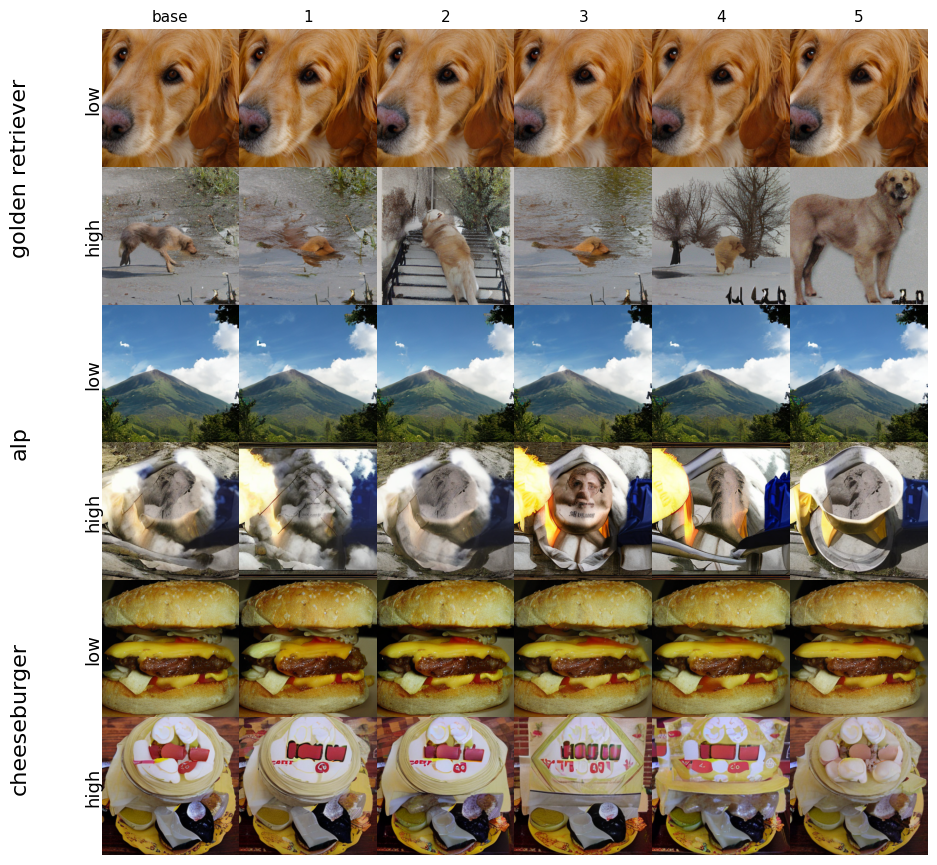

# Test-time Scaling for Diffusion Models using Generative Uncertainty

Code for my BSc thesis (University of Amsterdam, 2026), supervised by Metod Jazbec.
**Thesis: [`thesis/thesis.pdf`](thesis/thesis.pdf)**

This repository is a fork of [DIFF-UQ](https://github.com/metodj/DIFF-UQ), the code for
[Generative Uncertainty in Diffusion Models](https://arxiv.org/abs/2502.20946) (Jazbec et al., 2025).
Generative uncertainty scores a sample by how much M completions of the same initial noise disagree
semantically. The original work obtains these completions from a Laplace posterior over the network
weights and uses the score as a post-hoc filter. This thesis

1. replaces the weight perturbations with perturbations of the initial noise, so the M completions
   come from a single model, and
2. uses the resulting score as the objective of a zero-order search over the initial noise, and
   compares it against CLIP-based verifiers.

All experiments use class-conditional ImageNet 256x256 with a U-ViT-H/2 backbone.

<p align="center">
  
</p>

## Repository structure

```
├── UViT/                   sampling scripts (one main_*.py per method), U-ViT model and config
├── eval/                   FID / precision / recall (from EDM)
├── slurm/                  job scripts for the full pipeline, numbered in run order
├── figures/                plot scripts, notebook and the result figures
├── logs/                   SLURM output of the job scripts
├── thesis/thesis.pdf
├── semantic_likelihood.py  generative uncertainty from a folder of samples
└── requirements.txt
```

What this fork adds on top of DIFF-UQ:

| File | Method |
|---|---|
| `UViT/main_perturb.py` | Generative uncertainty from input (noise) perturbations instead of a Laplace posterior |
| `UViT/main_zo_uncert.py` | Zero-order search over the initial noise, minimising generative uncertainty |
| `UViT/main_zo_clip.py` | Zero-order search with a labelled CLIP verifier (zero-shot score of the target class) |
| `UViT/main_zo_clip_labelfree.py` | Zero-order search with a label-free CLIP verifier (confidence of the zero-shot classifier) |
| `slurm/`, `figures/` | Job scripts and figures |

This fork keeps only the U-ViT experiments; the ADM experiments are in the original repository.

## Setup

```bash
conda create --name diff-uq python=3.11
conda activate diff-uq
pip install -r requirements.txt
```

1. Download the [U-ViT checkpoint](https://drive.google.com/file/d/13StUdrjaaSXjfqqF7M47BzPyhMAArQ4u/view?usp=sharing)
   to `UViT/checkpoints/imagenet256_uvit_huge.pth` and the
   [Stable Diffusion autoencoder](https://drive.google.com/drive/folders/1yo-XhqbPue3rp5P57j6QbA5QZx6KybvP?usp=sharing)
   to `UViT/checkpoints/stable-diffusion/autoencoder_kl_ema.pth`.
2. Download [ImageNet](https://www.image-net.org/), set its path in `UViT/configs/imagenet256_uvit_huge.py`
   (used to fit the Laplace posterior) and as `source` in `eval/dataset_tool.sh`.
3. Compute the FID reference statistics: `cd eval && sbatch dataset_tool.sh`.

The experiments ran on the Snellius cluster (SLURM, H100). There the job scripts load the cluster's
Python module and use packages installed with `pip install --user -r requirements.txt`. On another
cluster, replace the `module` and `export PYTHONPATH` lines with `conda activate diff-uq`.

## Running the pipeline

Submit the job scripts from the repository root, e.g. `sbatch slurm/job1_generate_laplace.sh`.

1. **Generate samples** with one of the `job1_*` scripts:

   | Script | Method | Output in `UViT/UVIT_sample_results/` |
   |---|---|---|
   | `job1_generate_laplace.sh` | Laplace posterior (DIFF-UQ) | `laplace/`: folder `0` (MAP) and `1..M` (posterior samples) |
   | `job1_generate_perturb.sh` | Input perturbation | `perturb/`: folder `0` (base sample) and `1..M` (perturbed) |
   | `job1_generate_zo_uncert.sh` | Search, generative uncertainty | `zo_uncert/`: folder `0` and `zo_trajectory*.npy` |
   | `job1_generate_zo_clip.sh` | Search, labelled CLIP | `zo_clip/`: folder `0` and `zo_trajectory*.npy` |
   | `job1_generate_zo_clip_labelfree.sh` | Search, label-free CLIP | `zo_clip_labelfree/`: folder `0` and `zo_trajectory*.npy` |

   The three search scripts run as a 5-task SLURM array (`#SBATCH --array=0-4`). Each task generates
   its share of the 10K images into the same folder and saves its own trajectory file.

2. **Compute generative uncertainty** with `job2_semantic_likelihood.sh`. This writes
   `entropy_clip.npy` into the experiment folder.
3. **Evaluate** FID, precision and recall with `job3_eval.sh`, for the full set and after filtering
   by generative uncertainty.

With the default settings, `job2` and `job3` run on the output of `job1_generate_laplace.sh`. For
another run, set `path` (job2) and `EXP` (job3) to the experiment folder, which is the last line of the
`job1` log in `logs/generate/` (prefixed with `UViT/` and `../UViT/`). The search runs only produce folder `0`: skip `job2` and
evaluate them on all 10K samples from `eval/`:

```bash
python fid.py calc --images="${EXP}/0/imgs" --ref=./fid-refs/imagenet-256x256.npz --num 10000 --fid_features="${EXP}/0/fid_features.pt"
python precision_recall_torch.py --ref ./precision-recall-refs/image_net_256_fid_features_.pt --eval "${EXP}/0/fid_features.pt"
```

## Acknowledgements

This code builds on [DIFF-UQ](https://github.com/metodj/DIFF-UQ), [U-ViT](https://github.com/baofff/U-ViT),
[BayesDiff](https://github.com/karrykkk/BayesDiff) and [EDM](https://github.com/NVlabs/edm). The code in
`eval/` comes from EDM and is licensed under
[CC BY-NC-SA 4.0](https://creativecommons.org/licenses/by-nc-sa/4.0/).
